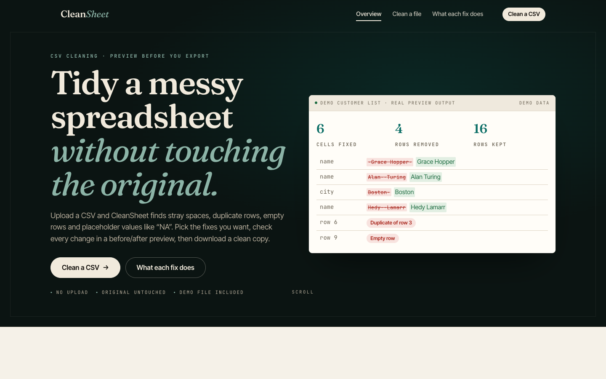
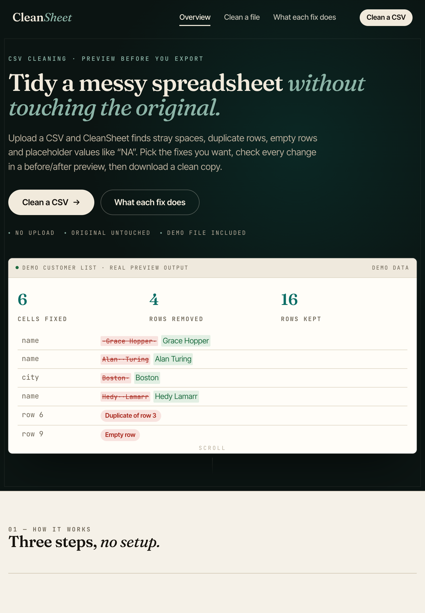
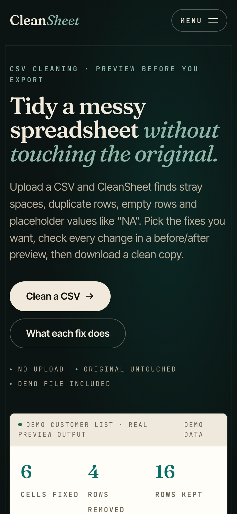
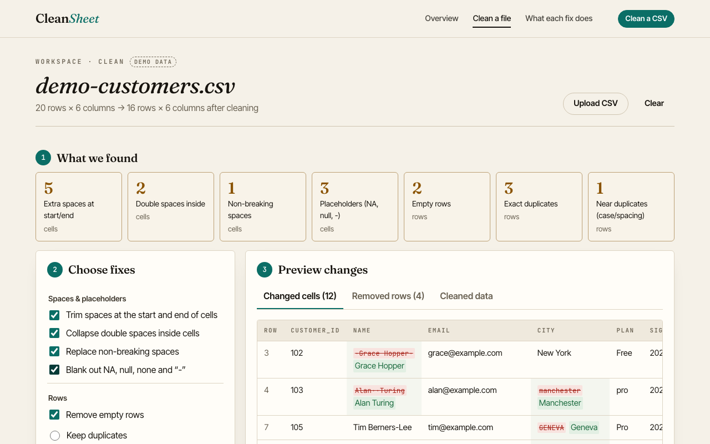
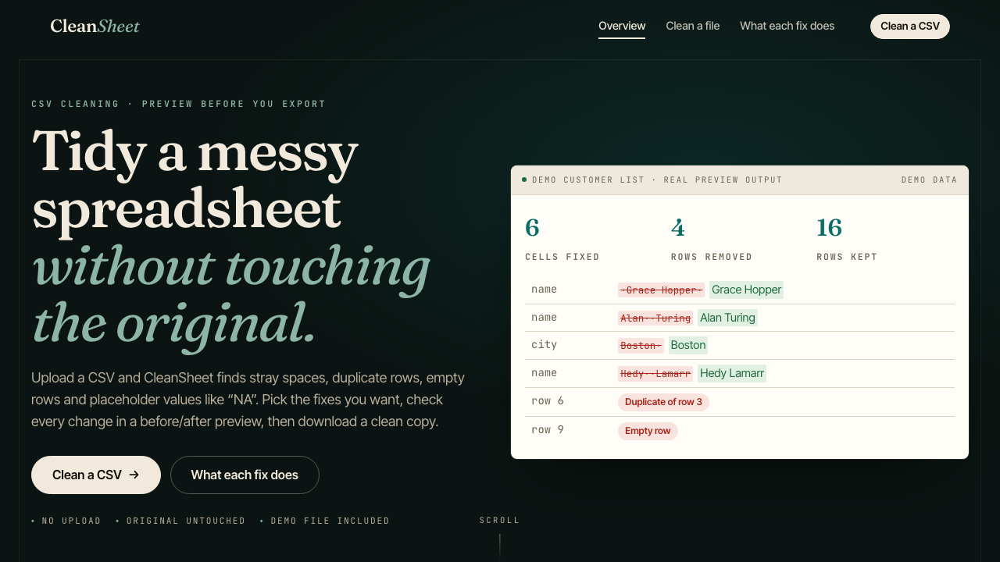
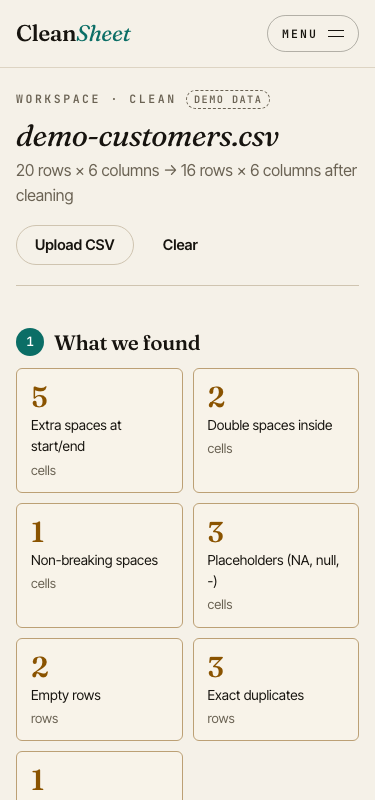

# CleanSheet

<!-- screenshots:start -->
<p align="center">
  
</p>
<p align="center">
  
  &nbsp;&nbsp;
  
</p>
<p align="center"><sub>Mac (1440×900) · Tablet (820×1180) · Phone (390×844)</sub></p>
<!-- screenshots:end -->

Clean a messy CSV safely: detect stray and double spaces, non-breaking spaces, placeholder values, empty rows and duplicates; choose which fixes to apply; review every changed cell and removed row in a before/after preview; then download a new, clean file.

**Live demo:** [https://kavishtolani.github.io/cleansheet/](https://kavishtolani.github.io/cleansheet/) — runs entirely in your browser; demo data is fictional and labelled.



| Landing | Mobile |
| --- | --- |
|  |  |

## Run it

```bash
npm install
npm run dev        # http://localhost:5118
npm test
npm run build
npm run test:e2e   # Playwright smoke test (npm run e2e:install once if Chromium is missing)
```

## Main workflow

1. **Clean a file** opens with a labelled, fictional customer list containing every kind of mess (spaces, non-breaking space, NA/null/-, empty rows, exact and case-only duplicates).
2. **What we found** — counts per issue type.
3. **Choose fixes** — spaces & placeholders, empty rows, duplicates (keep / exact / ignore case & spacing / key columns, with validation that a key is chosen), per-column letter case, drop columns. Choices are remembered.
4. **Preview changes** — changed cells shown as ~~old~~ → new with invisible spaces made visible (· and ⍽), removed rows with the reason (“Duplicate of row 3”), and the cleaned data. Row numbers match the spreadsheet (header = row 1).
5. **Export** — a plain-language log of what will change, delimiter choice (comma/semicolon/tab), optional BOM for Excel, and **Download &lt;name&gt;-clean.csv**. The original is never modified.

## Tests

- `src/lib/csv.test.ts` — shared RFC 4180 parser/writer.
- `src/lib/clean.test.ts` — issue detection, cell cleaning (title case with apostrophes/hyphens), exact/loose/key de-duplication, empty rows, dropped columns, change tracking that ignores removed rows, visualisation.
- `src/App.test.tsx` — demo detection and removed rows, key-column validation and option changes, download success message, upload and empty state.
- `e2e/smoke.spec.ts` — choose fixes, preview, download and inspect the actual file contents; strict 375px checks.

## Limitations

- Keeps the first occurrence of duplicates; no “keep most complete row” merge.
- No type conversion (dates, numbers) — see DataScope for profiling.
- 5 MB, main-thread processing; no undo history beyond resetting options.

## Future improvements

- Merge duplicates by filling blanks from later rows; date/number normalisation; saving cleaning recipes to reuse.

## Licence

MIT — see [LICENSE](LICENSE).
